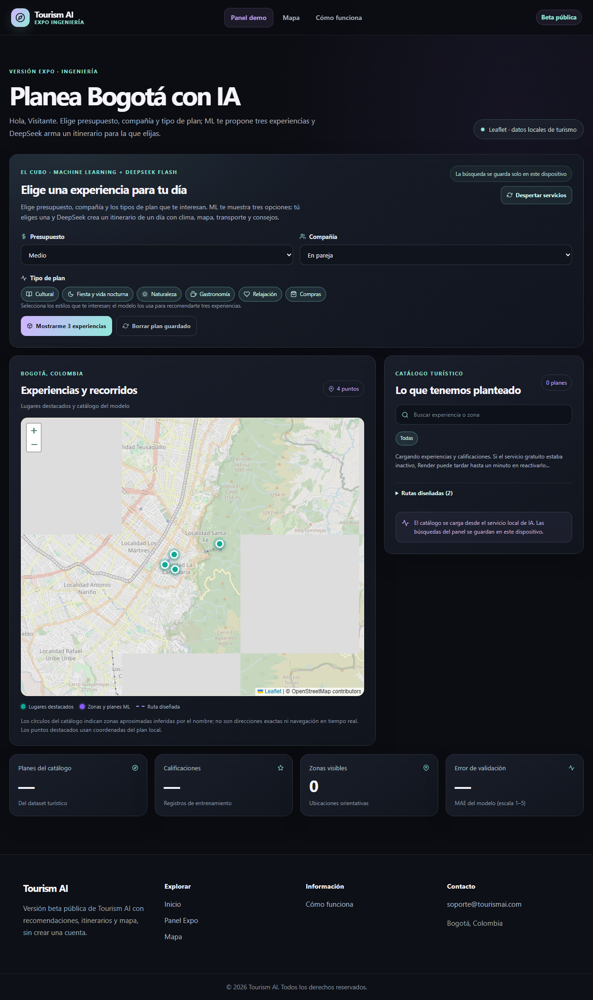
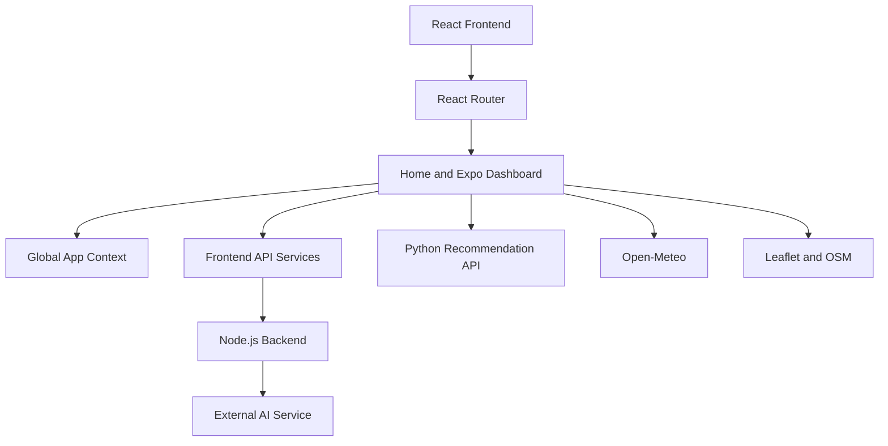

# Tourism AI Frontend

React and Vite interface for an AI-assisted tourism planner focused on plans in Bogotá.

The application combines a lightweight recommendation interface, Leaflet maps, OpenStreetMap data, weather information, saved local preferences, and optional integration with a Node.js backend and Python/FastAPI recommendation service.

## Live Demo

- [Production deployment](https://frontend-tourism-ai.vercel.app)
- [Expo dashboard](https://frontend-tourism-ai.vercel.app/expo)
- [Backend repository](https://github.com/AndresContreras1034/backend-tourismAI)

## Interface Preview

<p align="center">
  
</p>

## Implemented Features

- Tourism plan recommendation interface
- Budget, companion, and interest filters
- Cultural, nightlife, nature, gastronomy, relaxation, and shopping plans
- Leaflet and OpenStreetMap integration
- Approximate routes and local plan markers
- Tomorrow weather lookup
- Rain adaptation for itinerary suggestions
- AI itinerary assistant interface
- Optional image upload for visual analysis
- Local plan and result persistence
- Public exhibition dashboard
- Responsive navigation and application layout

## Architecture



The frontend keeps the application state for plans and filters in an `AppContext`. API communication is isolated under `src/services`.

## Technology Stack

| Technology | Role |
|---|---|
| React 19 | UI components |
| Vite | Development server and build |
| React Router | Route management |
| Leaflet | Interactive maps |
| React Leaflet | React map components |
| OpenStreetMap | Map tiles and geographic data |
| Framer Motion | Interface animation |
| React Icons | Interface icons |
| Fetch API | Backend communication |
| Open-Meteo | Weather information |

## Project Structure

```text
src/
  components/       Reusable UI components
  context/          Global application state
  core/             Core application logic
  data/             Static plan and category data
  hooks/            Reusable React hooks
  pages/            Home and Expo dashboard views
  routes/           Application route configuration
  services/         Backend and external API clients
  styles/           Shared styles
  utils/            Shared utilities
public/             Public static assets
vercel.json         SPA route fallback
```

## Requirements

- Node.js 20 or newer
- npm
- Optional Node.js backend
- Optional Python/FastAPI recommendation service
- External AI provider credentials configured only in the backend

## Environment Variables

Copy `.env.example` to `.env.local`:

```dotenv
VITE_API_URL=http://127.0.0.1:3001
VITE_AI_SERVICE_URL=http://127.0.0.1:8000
```

For production:

```dotenv
VITE_API_URL=https://your-backend.example
VITE_AI_SERVICE_URL=https://your-recommendation-api.example
```

Never place API provider secrets in `VITE_*` variables. They are visible in the browser build.

## Installation

```powershell
npm install
npm run dev
```

The Vite development server is available at `http://localhost:5173`.

## Available Commands

```powershell
npm run dev
npm run build
npm run lint
npm run preview
```

## Backend Integration

The frontend can communicate with:

- The Node.js backend through `VITE_API_URL`
- The recommendation API through `VITE_AI_SERVICE_URL`

When deployed, configure public URLs and keep secrets in the backend providers.

## Map and Weather Behavior

Leaflet coordinates come from geocoding results or a local approximate catalog.

Map lines represent sequences of stops, not complete road-navigation routes. Parking labels, prices, routes, and local availability should be confirmed before travel.

The weather panel uses public weather data. If backend weather access fails, the browser may query the public weather provider directly without regenerating the itinerary.

## Privacy

Plans and local preferences are stored in browser `localStorage`.

Images attached to the AI assistant are sent to the configured AI provider for analysis. They are not stored by the frontend. The backend controls credentials and provider-side retention.

Do not enter private API keys or sensitive personal information into demonstration forms.

## Deployment

The repository is configured for Vercel:

```powershell
npm run build
```

Use `dist` as the build output directory. `vercel.json` redirects application routes to `index.html` for browser routing.

The frontend deployment does not automatically deploy the Node.js or Python services.

## Known Limitations

- The public demo may depend on cold-start services.
- The recommendation backend may require local or separately deployed services.
- Leaflet coordinates and parking information are approximations.
- Prices and itineraries are suggestions, not confirmed travel availability.
- AI provider failures can limit itinerary generation.
- Automated tests are not included.
